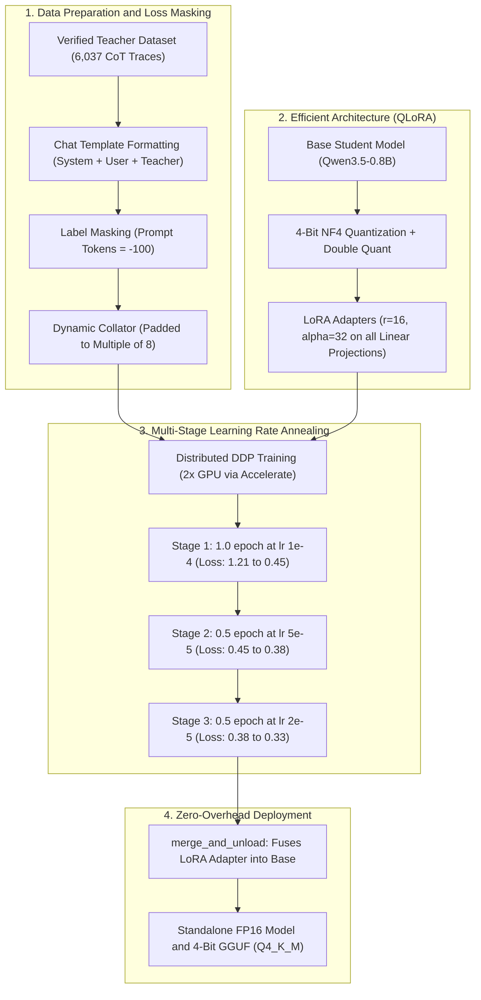

# Distilling Mathematical Reasoning into Qwen3.5-0.8B via QLoRA

[](https://www.python.org/)
[](https://pytorch.org/)
[](https://huggingface.co/docs/transformers)
[](https://github.com/huggingface/peft)
[](LICENSE)

An end-to-end framework for distilling multi-step Chain-of-Thought (CoT) mathematical reasoning from larger teacher models into a compact edge model (**Qwen3.5-0.8B**, ~758M parameters) on **GSM8K**. By combining 4-bit QLoRA, completion-only loss masking, and a 3-stage learning rate annealing schedule, the distilled student achieves an **+18.00% absolute accuracy boost (+55.7% relative)** while reducing inference latency by ~42%.

---

## 📊 Benchmark & Evaluation Results

Evaluated on 300 test problems from the standard **GSM8K** benchmark using exact-match answer extraction and 95% Wilson score confidence intervals.

| Model Variant | Precision / Weights | GSM8K Accuracy | 95% Confidence Interval | Eval Duration (300 items) | Trainable Params |
| :--- | :---: | :---: | :---: | :---: | :---: |
| **Qwen3.5-0.8B (Baseline)** | FP16 (758M) | 32.33% (97/300) | [27.33%, 38.00%] | 13m 57s | — |
| **Qwen3.5-0.8B (Distilled)** | Merged FP16 / GGUF | **50.33% (151/300)** | **[45.00%, 56.33%]** | **8m 05s (-42%)** | **6.39M (0.84%)** |

> **Key Finding:** The 95% confidence intervals do not overlap ([27.3%, 38.0%] vs [45.0%, 56.3%]), demonstrating a statistically significant improvement. Furthermore, inference time dropped by 42% because the distilled model learned direct, concise step-by-step reasoning that halts cleanly at `#### <answer>` rather than generating verbose, repetitive tokens.

### Empirical Visualizations
| Accuracy Comparison | Rolling Test Accuracy | Sequence Length Buckets |
| :---: | :---: | :---: |
|  |  |  |

---

## 🏗️ Architecture & Distillation Pipeline



---

## ⚙️ Methodology & Technical Highlights

### 1. Completion-Only Cross-Entropy Masking
In mathematical distillation, optimizing loss across prompt tokens causes the model to allocate representational capacity toward reproducing problem statements. We employ chat templates with system instructions and strictly mask prompt token positions with `-100` (`CrossEntropyLoss(ignore_index=-100)`):
$$\mathcal{L} = -\sum_{t = L_{\text{prompt}}}^{L_{\text{total}}} \log P(x_t \mid x_{<t})$$
This forces gradient updates to occur exclusively over the teacher's mathematical derivations and terminal answers.

### 2. Parameter-Efficient QLoRA Architecture
To enable high-throughput training on consumer-grade hardware:
* **Quantization:** Base weights are quantized to NormalFloat4 (NF4) with double quantization, maintaining the footprint below 2GB VRAM.
* **Target Modules:** LoRA adapters are injected across **all 7 linear projections** in the transformer layers:
  * Attention: `q_proj`, `k_proj`, `v_proj`, `o_proj`
  * MLP: `gate_proj`, `up_proj`, `down_proj`
* **Adapter Rank:** $r = 16$, $\alpha = 32$, yielding **6,389,760 trainable parameters (0.8421%)** out of 758,782,784 total parameters.

### 3. Progressive Multi-Stage Annealing Schedule
Sub-billion parameter models are vulnerable to catastrophic forgetting when subjected to extended high learning rates. Instead of a single static run, training was executed via progressive continuation stages:
* **Stage 1 (1.0 Epoch, $\text{LR} = 1\times 10^{-4}$):** Cosine decay with 3% warmup. Rapid structural convergence (loss: $1.216 \to 0.449$).
* **Stage 2 (0.5 Epochs, $\text{LR} = 5\times 10^{-5}$):** Adapter continuation to stabilize intermediate arithmetic steps (loss: $0.450 \to 0.380$).
* **Stage 3 (0.5 Epochs, $\text{LR} = 2\times 10^{-5}$):** Fine-grained convergence and formatting refinement (loss: $0.380 \to 0.334$).

### 4. Tensor-Core Hardware Alignment
The dynamic collator computes batch-level maximum lengths and dynamically pads them up to multiples of 8. Combined with `group_by_length=True`, this aligns sequence tensors with NVIDIA Tensor Core memory matrix layouts (WMMA/MMA instructions) and reduces wasteful padding FLOPs by over 30%.

---

## 🔬 Qualitative Reasoning Samples

Below are test set examples comparing model reasoning before and after distillation:

### Example 1: Multi-Step Arithmetic Deduction
* **Problem:** *Janet's ducks lay 16 eggs per day. She eats three for breakfast every morning and bakes muffins for her friends every day with four. She sells the remainder at the farmers' market daily for $2 per fresh duck egg. How much in dollars does she make every day?*
* **Gold Answer:** `18`
* **Distilled Model Output:**
  ```text
  16 eggs/day - 3 eaten - 4 baked = 9 eggs left.
  9 * $2 = $18.
  #### 18
  ```
* **Status:**  **Correct (Concise CoT derivation)**

### Example 2: Fractional Proportions
* **Problem:** *A robe takes 2 bolts of blue fiber and half that much white fiber. How many bolts in total does it take?*
* **Gold Answer:** `3`
* **Distilled Model Output:**
  ```text
  A robe takes 2 bolts of blue fiber and 2/2=<<2/2=1>>1 bolt of white fiber.
  So, a robe takes 2+1=<<2+1=3>>3 bolts of fiber in total.
  #### 3
  ```
* **Status:**  **Correct (Clean termination)**

---

## 🚀 Model Artifacts & Deployment

### Zero-Overhead Weight Fusion
To avoid the runtime latency of computing parallel adapter paths ($y = Wx + \frac{\alpha}{r}BAx$), the trained adapter is merged directly into the base model weights using PEFT's `merge_and_unload()`:
$$W_{\text{fused}} = W_{\text{base}} + \frac{\alpha}{r}(B \times A)$$
The merged model outputs standard Safetensors files with zero inference latency overhead.

### Edge Quantization (GGUF)
The merged model was quantized into GGUF format for local edge execution via `llama.cpp` or Ollama:
* **F16 GGUF:** ~1.5 GB
* **Q4_K_M GGUF:** ~529 MB (Runs at 60+ tokens/sec on mobile or CPU devices)

---

## 📁 Repository Structure

```text
├── assets/
│   └── plots/
│       ├── distilled_accuracy.png          # Baseline vs Distilled accuracy bar chart
│       ├── distilled_rolling_accuracy.png  # Rolling test accuracy progression
│       └── distilled_length_buckets.png    # Performance by input token length
├── data/
│   ├── eval_baseline_300.json              # Baseline benchmark metrics
│   └── eval_distilled_6000_cont2_300.json  # Distilled student benchmark metrics
├── notebooks/
│   └── qwen-distill.ipynb                  # Complete training & distillation notebook
├── snippets.py                             # Modular training pipeline implementation
├── requirements.txt                        # Python dependencies
└── README.md                               # Project documentation
```

---

## 💻 Quickstart

### Installation
```bash
git clone https://github.com/sujal-b/qwen-gsm8k-distill.git
cd qwen-gsm8k-distill
pip install -r requirements.txt
```

### Run Pipeline Modules
```bash
python snippets.py
```

---

## 📜 License
This project is licensed under the MIT License.
