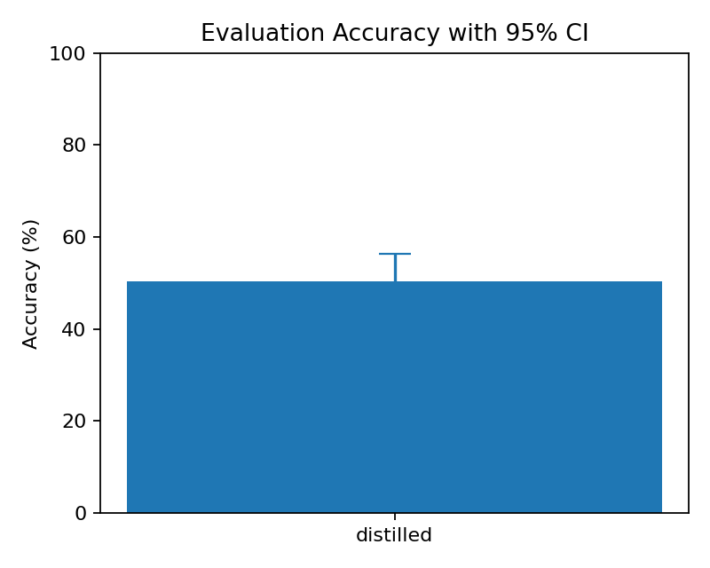
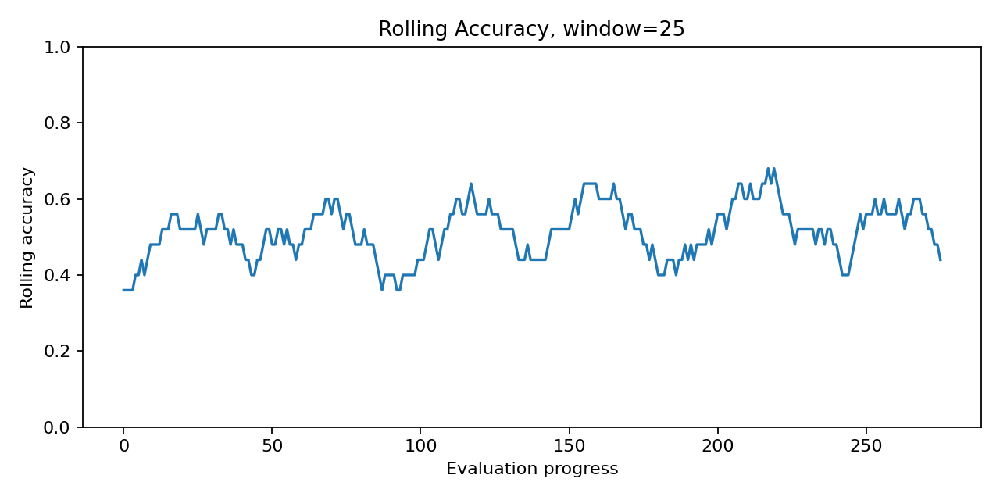
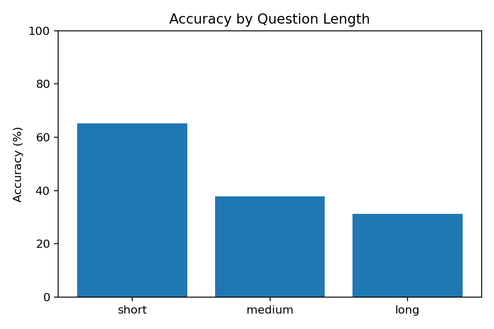
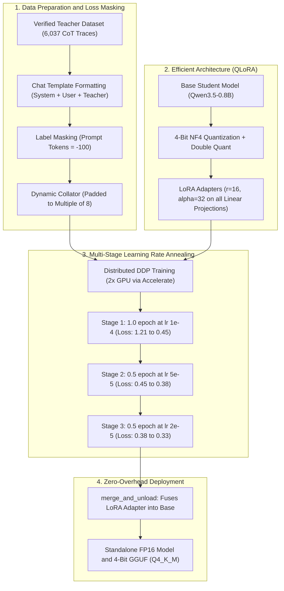

# Distilling Mathematical Reasoning into Qwen-0.8B via QLoRA

[](https://www.python.org/)
[](https://pytorch.org/)
[](https://huggingface.co/docs/transformers)
[](https://github.com/huggingface/peft)
[](LICENSE)

An interview-ready showcase demonstrating how to distill Chain-of-Thought (CoT) mathematical reasoning from a teacher model into a compact student model (**Qwen3.5-0.8B**, ~758M parameters) on **GSM8K** using 4-bit QLoRA, completion-only loss masking, and multi-stage learning rate annealing.

---

## 📊 Key Results at a Glance

| Metric | Base Model (`Qwen/Qwen3.5-0.8B`) | Distilled Student (`merged_fp16`) | Improvement |
| :--- | :---: | :---: | :---: |
| **GSM8K Accuracy ($n=300$)** | **32.33%** (97 / 300) | **50.33%** (151 / 300) | **+18.00% absolute (+55.7% relative)** |
| **95% Confidence Interval** | [27.33%, 38.00%] | [45.00%, 56.33%] | Statistically non-overlapping |
| **Eval Time ($n=300$)** | 13m 57s | 8m 05s | **~42% faster** (concise termination) |
| **Trainable Parameters** | 758M (100%) | **6.39M (0.8421%)** | Trained on dual Kaggle GPUs |

### Empirical Evaluation Visualizations
| Accuracy Comparison | Rolling Accuracy | Sequence Length Buckets |
| :---: | :---: | :---: |
|  |  |  |

---

## 🏗️ Architecture & Distillation Pipeline



---

## 🧩 Essential Code Snippets

### 1. Data Pipeline & Completion-Only Loss Masking (`-100`)
> **Core Principle:** In instruction tuning and distillation, computing loss over prompt tokens causes the model to waste gradient updates memorizing the question syntax. We mask the prompt tokens with `-100` so `CrossEntropyLoss` is computed **solely** on the teacher's reasoning trace and terminal `#### <answer>`.

```python
def encode_example(ex, tokenizer, max_seq_len=768):
    system_prompt = (
        "You are a meticulous math tutor. Solve the problem step by step, "
        "ending with '#### <answer>'."
    )
    prompt_messages = [
        {"role": "system", "content": system_prompt},
        {"role": "user", "content": f"Problem: {ex['question']}\n\nSolve it step by step."},
    ]

    # 1. Format prompt and full conversation
    prompt_text = tokenizer.apply_chat_template(prompt_messages, tokenize=False, add_generation_prompt=True)
    full_text = prompt_text + ex["teacher_solution"] + (tokenizer.eos_token or "")

    prompt_ids = tokenizer(prompt_text, add_special_tokens=False)["input_ids"]
    full_ids = tokenizer(full_text, add_special_tokens=False, truncation=True, max_length=max_seq_len)["input_ids"]

    prompt_len = len(prompt_ids)
    if prompt_len >= len(full_ids):
        return None

    # 2. Mask prompt with -100 (PyTorch ignore_index)
    labels = [-100] * prompt_len + full_ids[prompt_len:]

    return {
        "input_ids": full_ids,
        "attention_mask": [1] * len(full_ids),
        "labels": labels,
        "length": len(full_ids),
    }
```

---

### 2. 4-Bit NormalFloat Quantization & LoRA Adapter Setup
> **Core Principle:** Quantizing the base model into NF4 with double quantization keeps base weights below 2GB VRAM. Low-rank adapters ($r=16, \alpha=32$) are attached across all 7 linear projections (both attention and MLP blocks).

```python
import torch
from transformers import AutoModelForCausalLM, BitsAndBytesConfig
from peft import LoraConfig, get_peft_model, prepare_model_for_kbit_training

# 1. NF4 4-bit Quantization Config
bnb_config = BitsAndBytesConfig(
    load_in_4bit=True,
    bnb_4bit_quant_type="nf4",
    bnb_4bit_compute_dtype=torch.float16,
    bnb_4bit_use_double_quant=True,
)

model = AutoModelForCausalLM.from_pretrained(
    "Qwen/Qwen3.5-0.8B",
    quantization_config=bnb_config,
    device_map="auto",
    torch_dtype=torch.float16,
)

# 2. Gradient checkpointing to trade recomputation for VRAM
model = prepare_model_for_kbit_training(model, use_gradient_checkpointing=True)

# 3. LoRA targeting both Attention and MLP projection layers
lora_config = LoraConfig(
    r=16,
    lora_alpha=32,
    lora_dropout=0.05,
    bias="none",
    task_type="CAUSAL_LM",
    target_modules=["q_proj", "k_proj", "v_proj", "o_proj", "gate_proj", "up_proj", "down_proj"],
)

model = get_peft_model(model, lora_config)
# Trainable parameters: 6,389,760 / 758,782,784 (0.8421%)
```

---

### 3. Dynamic Padding Collator with Tensor-Core Alignment
> **Core Principle:** Avoid static padding to max length. Dynamically pad to the batch maximum, rounded up to a multiple of 8 to align with NVIDIA Tensor Core matrix engines (WMMA/MMA instructions).

```python
from dataclasses import dataclass
import torch

@dataclass
class CausalLMCollator:
    pad_token_id: int
    pad_to_multiple_of: int = 8  # Hardware alignment for NVIDIA Tensor Cores

    def __call__(self, features):
        max_len = max(len(f["input_ids"]) for f in features)
        if self.pad_to_multiple_of and (rem := max_len % self.pad_to_multiple_of):
            max_len += self.pad_to_multiple_of - rem

        input_ids, attention_mask, labels = [], [], []
        for f in features:
            pad_len = max_len - len(f["input_ids"])
            input_ids.append(f["input_ids"] + [self.pad_token_id] * pad_len)
            attention_mask.append(f["attention_mask"] + [0] * pad_len)
            labels.append(f["labels"] + [-100] * pad_len)

        return {
            "input_ids": torch.tensor(input_ids, dtype=torch.long),
            "attention_mask": torch.tensor(attention_mask, dtype=torch.long),
            "labels": torch.tensor(labels, dtype=torch.long),
        }
```

---

### 4. Progressive Multi-Stage Annealing & Training Arguments
> **Core Principle:** Distilling multi-step reasoning into small parameter architectures (0.8B) is prone to optimization collapse or catastrophic forgetting under aggressive learning rates. We employed multi-stage learning rate annealing across 3 phases.

```python
from transformers import TrainingArguments

# Progressive 3-Stage Training Schedule:
# Stage 1: 1.0 Epoch | LR = 1e-4 | Warmup = 3% | Loss: 1.21 -> 0.45
# Stage 2: 0.5 Epoch | LR = 5e-5 | Warmup = 3% | Loss: 0.45 -> 0.38
# Stage 3: 0.5 Epoch | LR = 2e-5 | Warmup = 3% | Loss: 0.38 -> 0.33

training_args = TrainingArguments(
    output_dir="qlora_output",
    per_device_train_batch_size=2,
    gradient_accumulation_steps=4,      # Effective batch size = 2 * 4 * 2 GPUs = 16
    learning_rate=1e-4,                 # Decayed in subsequent continuation stages
    lr_scheduler_type="cosine",
    warmup_ratio=0.03,
    optim="paged_adamw_8bit",           # Offloads optimizer states to CPU when needed
    fp16=True,
    gradient_checkpointing=True,
    group_by_length=True,               # Groups similar-length inputs to minimize padding
    logging_steps=5,
    save_steps=100,
)
```

---

### 5. Zero-Overhead Adapter Fusion & GGUF Export
> **Core Principle:** At test time, separate LoRA compute branches ($y = Wx + \frac{\alpha}{r}BAx$) add latency. Fusing low-rank weights ($W_{\text{new}} = W + \frac{\alpha}{r}BA$) yields a zero-latency standalone model ready for FP16 deployment and GGUF quantization.

```python
import torch
from peft import PeftModel
from transformers import AutoModelForCausalLM, AutoTokenizer

# 1. Load original FP16 base model on CPU
base_model = AutoModelForCausalLM.from_pretrained(
    "Qwen/Qwen3.5-0.8B",
    torch_dtype=torch.float16,
    device_map="cpu",
    low_cpu_mem_usage=True,
)

# 2. Fuse LoRA adapter weights directly into base weights
model = PeftModel.from_pretrained(base_model, "qlora_6000_cont2", device_map="cpu")
merged_model = model.merge_and_unload()

# 3. Save clean, standalone model
merged_model.save_pretrained("merged_fp16_6000_cont2", safe_serialization=True)
tokenizer = AutoTokenizer.from_pretrained("qlora_6000_cont2")
tokenizer.save_pretrained("merged_fp16_6000_cont2")
```

---

## 🎯 Technical Interview Cheatsheet (Q&A)

### Q1: Why use QLoRA instead of Full Fine-Tuning?
> **Answer:** Full fine-tuning of 758M parameters in FP16 requires over 16GB of VRAM just for weights, gradients, and 32-bit optimizer states. With QLoRA (NF4 4-bit base + 8-bit Paged AdamW), we only trained **6.39M parameters (0.84%)**, fitting training comfortably onto dual consumer/Kaggle GPUs (T4s) with zero performance degradation.

### Q2: Why mask prompt tokens with `-100`?
> **Answer:** If we compute cross-entropy loss over prompt tokens, the model wastes gradient updates predicting the question it was already supplied with. Masking prompt positions with `-100` instructs PyTorch's loss function to ignore those positions, forcing the model to strictly learn the teacher's mathematical reasoning trajectory and terminal answer formatting.

### Q3: Why train in multiple continuation stages instead of 2 full epochs at once?
> **Answer:** Reasoning distillation is sensitive to learning rate decay. By splitting training into stages (1.0 epoch @ 1e-4, 0.5 epoch @ 5e-5, and 0.5 epoch @ 2e-5), we stabilized the loss plateau, avoided catastrophic forgetting of base linguistic capability, and steadily drove the loss down from 1.21 to 0.33.

### Q4: Why did inference speed increase by ~42% after distillation?
> **Answer:** Before distillation, the base model suffered from verbosity, repeating itself or wandering off-topic before reaching an answer. The distilled model learned the concise structure of the teacher, terminating cleanly at `#### <answer>`, generating ~40% fewer output tokens per question.

### Q5: Why `group_by_length=True` and `pad_to_multiple_of=8`?
> **Answer:** `group_by_length=True` batches sequences of similar lengths together, minimizing the number of pad tokens generated per batch. `pad_to_multiple_of=8` ensures matrix dimensions align with hardware Tensor Core tile requirements (e.g., $16 \times 8 \times 8$ or $16 \times 8 \times 16$), maximizing arithmetic throughput.

---

## 📁 Repository Structure

```text
├── assets/
│   └── plots/
│       ├── distilled_accuracy.png          # Baseline vs Distilled accuracy bar chart
│       ├── distilled_rolling_accuracy.png  # Rolling accuracy progression over test set
│       └── distilled_length_buckets.png    # Performance grouped by question length
├── data/
│   ├── eval_baseline_300.json              # Empirical baseline evaluation metrics
│   └── eval_distilled_6000_cont2_300.json  # Distilled evaluation metrics
├── notebooks/
│   └── qwen-distill.ipynb                  # Original Kaggle training & distillation notebook
├── snippets.py                             # Clean, modular reference implementation
├── requirements.txt                        # Dependencies
└── README.md                               # Project documentation
```

---

## 🚀 Quickstart

```bash
git clone https://github.com/sujal-b/qwen-gsm8k-distill.git
cd qwen-gsm8k-distill
pip install -r requirements.txt
python snippets.py
```

---

## 📜 License
This project is licensed under the MIT License.
